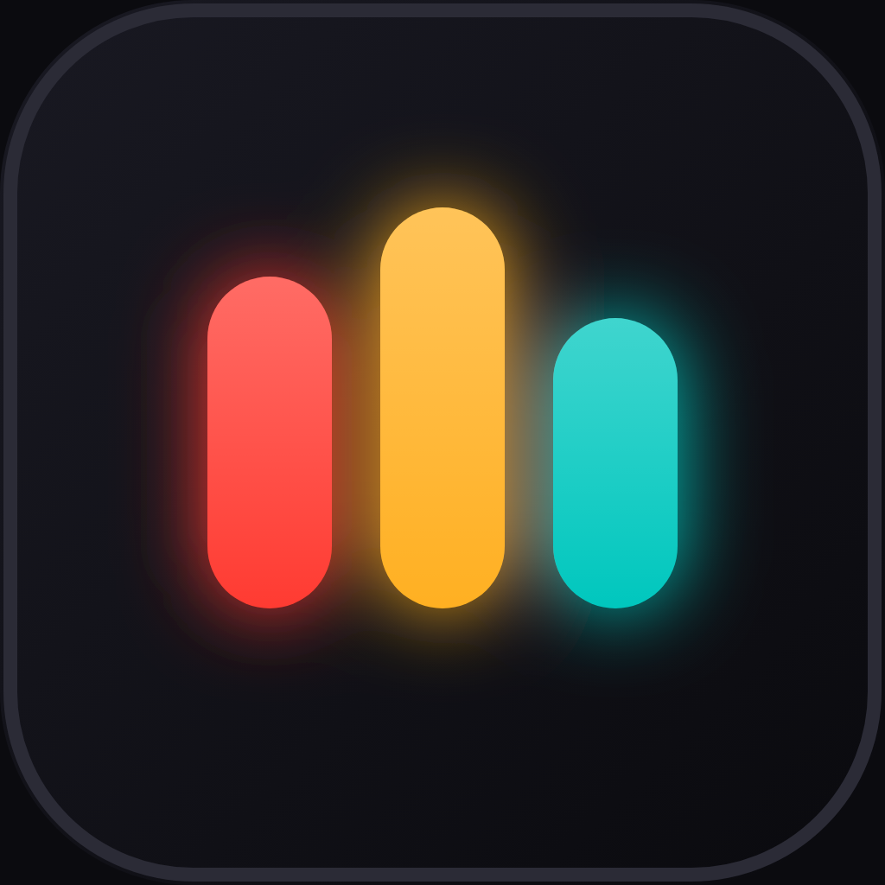
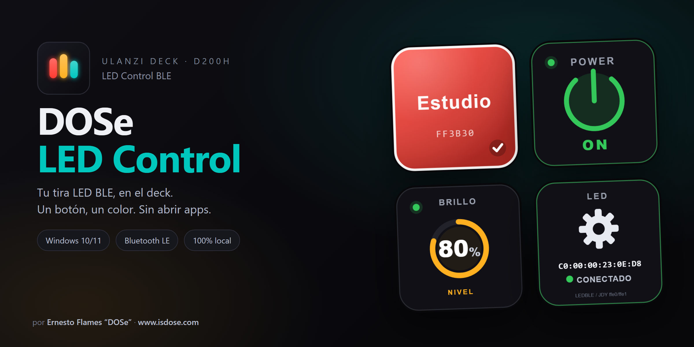
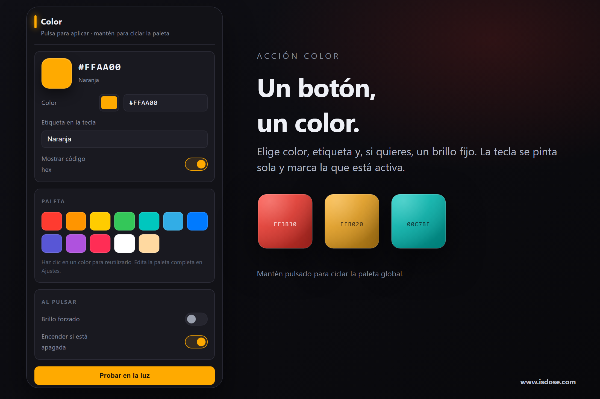
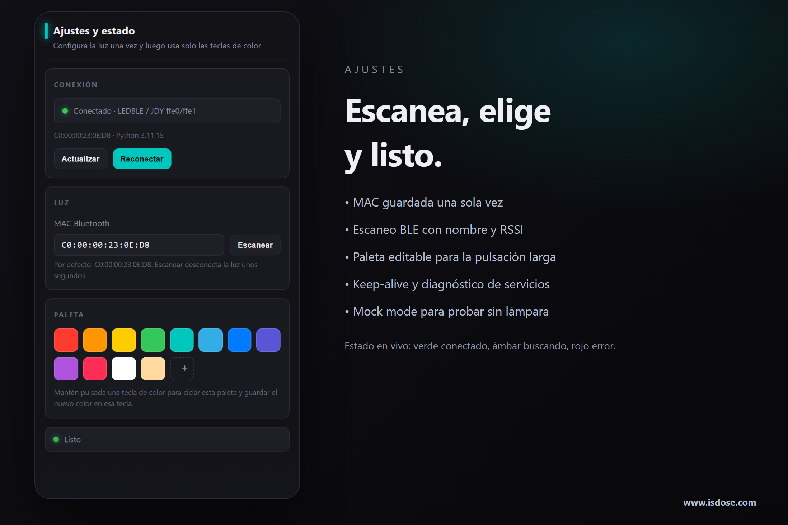
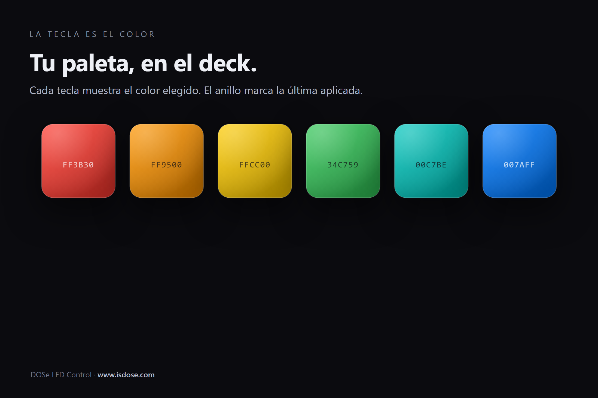

<div align="center">



<h1>DOSe LED Control</h1>

<p><strong>Tu tira LED RGB por Bluetooth, convertida en teclas físicas.</strong><br />
Un botón, un color. Sin abrir apps, sin cuenta, sin nube.</p>

<p>
  <a href="README.en.md">🇬🇧 English</a> ·
  <a href="https://isdose.github.io/ulanzi-led-control/">Sitio web</a> ·
  <a href="#instalación">Instalación</a> ·
  <a href="#capturas">Capturas</a> ·
  <a href="docs/INSTALL.md">Guía completa</a> ·
  <a href="https://www.isdose.com">www.isdose.com</a>
</p>

<p>
  
  
  
  
  
  <a href="https://github.com/isDOSe/ulanzi-led-control/actions/workflows/ci.yml"></a>
</p>



</div>

> [!NOTE]
> **Beta 0.1.2** — protocolo, servicios BLE y escritura verificados contra una
> lámpara real (`LEDBLE-00-D80E`, `ffe0/ffe1`, `write-without-response`). La
> validación de gestos y latencia en el D200H sigue abierta. Ver
> [`docs/TESTING.md`](docs/TESTING.md).

---

## La idea

Las tiras LED chinas se controlan con una app de móvil que tarda en conectar,
pierde el dispositivo y no recuerda tu color favorito. Mientras tanto, el
**Ulanzi D200H** tiene 13 teclas LCD delante de ti.

Este plugin convierte el deck en el panel de luz que debió venir de fábrica:

- **Cada tecla de color es su color**, con etiqueta y hex a la vista.
- La pulsación normal aplica; la **pulsación larga** cicla la paleta global y
  guarda el color nuevo en esa tecla.
- Un **puente BLE persistente** mantiene el enlace caliente: pulsar no cuesta
  los 1–4 s de escaneo y conexión de cada vez.
- **Todo ocurre en tu PC.** Sin cuenta, sin nube, sin telemetría.

## Qué incluye

| Acción | Qué hace | Pulsación larga |
|---|---|---|
| **Color** | Aplica el color configurado (brillo opcional y encendido automático) | Cicla la paleta global y guarda el nuevo color en esa tecla |
| **Power** | Enciende / apaga | — |
| **Brightness** | Nivel fijo, subir/bajar por pasos o ciclo 25→50→75→100 | — |
| **Settings & Status** | Muestra MAC, protocolo y estado; pulsa para reconectar | Reinicia el puente BLE |

La tecla de color marca con un anillo la que está activa y avisa si el puente
está caído. La tecla de ajustes muestra el estado en vivo: **verde** conectado,
**ámbar** buscando, **rojo** error.

## Capturas

<p align="center">
  
  
</p>
<p align="center">
  
</p>

<p align="center">
  <a href="docs/key-preview.html"><strong>→ Ver todas las teclas en tamaño real (preview interactivo)</strong></a>
</p>

## Instalación

### Requisitos

- **Windows 10/11** (la versión actual se publica solo para Windows).
- **Ulanzi Studio 3.4+** (probado con 3.4.4) con el D200H conectado.
- **Python 3.10+** con [`bleak`](https://github.com/hbldh/bleak):
  ```powershell
  pip install bleak
  ```
- **Node.js** solo para desarrollar; Ulanzi Studio ya incluye su runtime Node 20.

### Desde el ZIP

1. Descarga `com.dose.ledcontrol.ulanziPlugin-0.1.2.zip` desde
   [Releases](https://github.com/isDOSe/ulanzi-led-control/releases/latest).
2. Descomprime la carpeta `com.dose.ledcontrol.ulanziPlugin` en
   `%APPDATA%\Ulanzi\UlanziDeck\Plugins\`.
3. Instala `bleak` y reinicia Ulanzi Studio.

### Desde el código

```powershell
git clone https://github.com/isDOSe/ulanzi-led-control.git
cd ulanzi-led-control

npm run setup     # instala ws dentro del plugin
npm test          # validador + tests de protocolo, render, puente e identidad
npm run deploy    # copia el plugin a %APPDATA%\Ulanzi\UlanziDeck\Plugins
```

Reinicia **Ulanzi Studio** por completo (el servicio principal es un proceso
Node de larga duración; cerrar el panel no recarga el código).

### Primera configuración

1. Arrastra **Settings & Status** a una tecla.
2. Abre su panel, pulsa **Scan** y elige tu lámpara (o deja la MAC de ejemplo).
3. **Save settings** → **Reconnect**. La tecla debe ponerse verde.
4. Añade teclas **Color**, elige color y etiqueta, y prueba con **Test on light**.

Guía paso a paso, actualización y desinstalación: [`docs/INSTALL.md`](docs/INSTALL.md).

## Cómo funciona

```
┌──────────┐   USB   ┌────────────────────┐   WebSocket   ┌─────────────────┐
│  D200H   │────────►│  Ulanzi Studio     │◄─────────────►│ plugin/app.js   │
└──────────┘         └────────────────────┘               │  (Node 20)      │
                                                          └────────┬────────┘
                                                                   │ stdio NDJSON
                                                          ┌────────▼────────┐
                                                          │ ble_bridge.py   │
                                                          │ (Python/bleak)  │
                                                          └────────┬────────┘
                                                                   │ BLE GATT
                                                              ┌────▼────┐
                                                              │  Tira   │
                                                              │  LED    │
                                                              └─────────┘
```

El puente se lanza al arrancar el plugin y mantiene la conexión BLE abierta.
Cada pulsación es un mensaje NDJSON; el puente escribe la trama `7E … EF` y
devuelve el estado. Si el BLE se atasca, se reinicia el puente sin tocar el
plugin. Detalles en [`docs/ARCHITECTURE.md`](docs/ARCHITECTURE.md) y
[`docs/BLE-PROTOCOL.md`](docs/BLE-PROTOCOL.md).

## Compatibilidad

Pensado para controladores BLE baratos del ecosistema `led-control`:

| Familia | Servicio / característica | Protocolo |
|---|---|---|
| ELK-BLEDOM | `fff0` / `fff3` (o `fff1`) | `7E … EF` |
| LEDBLE / JDY | `ffe0` / `ffe1` | `7E … EF` |
| LED LAMP (custom) | `305bdd41-…` | `7E … EF` |
| Magic Blue | `ffe5` / `ffe9` | `56 … AA` |
| Clones genéricos | primera característica escribible | `7E … EF` |

El protocolo se detecta automáticamente y se cachea por MAC, así que la segunda
conexión es instantánea. Si tu lámpara no aparece, revisa
[`docs/BLE-PROTOCOL.md`](docs/BLE-PROTOCOL.md) y abre un issue con el modelo.

## Ajustes globales

- **MAC Bluetooth**: se guarda una sola vez. **Scan** lista dispositivos con
  RSSI y etiqueta los que parecen tiras LED.
- **Palette**: colores del ciclo por pulsación larga (2–24).
- **Keep-alive**: mantiene el enlace caliente (30 s por defecto). Ponlo a 0 si
  tu controlador parpadea estando inactivo.
- **Python executable**: solo si la autodetección falla.
- **Mock mode**: simula la lámpara para probar la UI sin Bluetooth.
- **Verbose bridge logs** + **Open data folder** para depurar.

## Problemas comunes

| Síntoma | Causa / solución |
|---|---|
| «No se encontró Python» | Instala Python 3.10+ y marca *Add to PATH*, o pon la ruta en Ajustes → Advanced. |
| «bleak no está instalado» | `pip install bleak` con **el mismo Python** que usa el plugin (el panel de estado muestra cuál es). |
| La tecla de ajustes está roja | Pulsa la tecla para reconectar; revisa `bridge.log`. |
| La lámpara no aparece en Scan | Enciéndela, acerca el PC y cierra la app del móvil que la tenga conectada. |
| Primera pulsación lenta | Normal si la lámpara estaba dormida; el keep-alive lo evita. |
| Parpadea estando quieta | Keep-alive a 0 en Advanced. |
| Cambié código y no pasa nada | Reinicia Ulanzi Studio: el servicio Node no se recarga solo. |
| El color no es exacto | Es un LED RGB barato; ajusta el brillo con **Brightness override**. |

Checklist de pruebas y depuración avanzada: [`docs/TESTING.md`](docs/TESTING.md).

## Desarrollo

```powershell
npm run setup        # dependencias del plugin (ws)
npm test             # validador + 10 comprobaciones + test de identidad
npm run test:py      # tramas BLE exactas (unittest)
npm run preview      # regenera docs/key-preview.html
npm run assets       # icono, portada, banners y capturas de tienda
npm run package      # dist/com.dose.ledcontrol.ulanziPlugin-<versión>.zip
npm run bridge       # puente real por consola
npm run bridge:mock  # puente simulado
npm run deploy       # copia a APPDATA conservando data/
```

### Estructura

```
ulanzi-led-control/
├─ com.dose.ledcontrol.ulanziPlugin/   ← lo que se despliega
│  ├─ manifest.json
│  ├─ en.json / es_ES.json
│  ├─ assets/icons/                    ← iconos SVG
│  ├─ plugin/
│  │  ├─ app.js                        ← servicio principal (acciones + bus PI)
│  │  ├─ bridge.js                     ← cliente NDJSON del puente Python
│  │  ├─ render.js                     ← arte de las teclas (SVG)
│  │  ├─ settings.js                   ← settings globales + helpers
│  │  ├─ actions/                      ← color, power, brightness, settings
│  │  └─ sdk/                          ← UlanziDeck SDK (Apache-2.0)
│  ├─ property-inspector/              ← UI de configuración
│  ├─ backend/
│  │  ├─ ble_bridge.py                 ← puente BLE persistente
│  │  ├─ led_protocol.py               ← tramas 7E…EF + tabla de UUIDs
│  │  └─ test_led_protocol.py
│  ├─ libs/                            ← SDK HTML (PI) + assets
│  └─ data/                            ← settings.json, caché, logs (runtime)
├─ tools/                              ← deploy, tests, preview, assets, paquete
└─ docs/                               ← arquitectura, protocolo, guías y tienda
```

Logs y datos en
`%APPDATA%\Ulanzi\UlanziDeck\Plugins\com.dose.ledcontrol.ulanziPlugin\data\`:
`bridge.log` (BLE), `plugin.log` (eventos), `settings.json`,
`action-params.json` y `protocol-cache.json`.

## Documentación

- [`docs/PLAN.md`](docs/PLAN.md) — decisiones, alcance y criterios de aceptación.
- [`docs/ROADMAP.md`](docs/ROADMAP.md) — qué viene después.
- [`docs/ARCHITECTURE.md`](docs/ARCHITECTURE.md) — componentes y protocolo interno.
- [`docs/BLE-PROTOCOL.md`](docs/BLE-PROTOCOL.md) — tramas, UUIDs y detección.
- [`docs/TESTING.md`](docs/TESTING.md) — pruebas automáticas y manuales.
- [`docs/INSTALL.md`](docs/INSTALL.md) — instalación detallada.
- [`docs/PUBLISHING.md`](docs/PUBLISHING.md) — publicación en el Ulanzi Workshop.
- [`docs/CHANGELOG.md`](docs/CHANGELOG.md) — historial de versiones.
- [`docs/store/`](docs/store/README.md) — ficha ES/EN y assets de tienda.

## Hoja de ruta

- **0.1.3** — validar gestos y latencia en el D200H, afinar keep-alive.
- **0.2.0** — efectos, blanco/temperatura, tecla de estado y doble pulsación.
- **0.3.0** — varias lámparas, encoders del D200X, escenas.
- **1.0.0** — instalador sin Python, CI y soporte macOS verificado.

Detalle y prioridades en [`docs/ROADMAP.md`](docs/ROADMAP.md).

## Privacidad

El plugin no abre conexiones de red, no pide cuentas y no envía telemetría.
Solo habla con tu lámpara por Bluetooth LE y escribe sus ajustes y logs dentro
de su propia carpeta `data/`.

## Contribuir

¿Tienes otra tira BLE, un D200X o una idea? Los issues y PRs son bienvenidos:
lee [`CONTRIBUTING.md`](CONTRIBUTING.md) para montar el entorno y pasar los
tests. Si el plugin te resulta útil, **deja una estrella** ⭐ — ayuda a que más
gente lo encuentre.

## Licencia

[MIT](LICENSE) © 2026 Ernesto Flames (DOSe) · [www.isdose.com](https://www.isdose.com)

El SDK de Ulanzi se distribuye bajo Apache-2.0; ver
[`THIRD-PARTY-LICENSES.md`](com.dose.ledcontrol.ulanziPlugin/THIRD-PARTY-LICENSES.md).

<div align="center">
  <sub>Hecho con cariño y demasiadas pruebas de color · <a href="https://www.isdose.com">isdose.com</a></sub>
</div>
